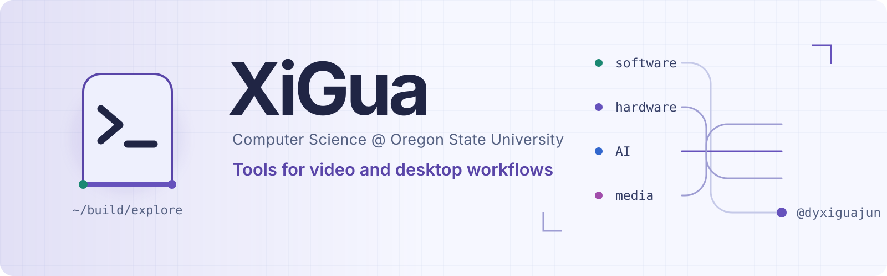

  <picture>
    <source media="(prefers-color-scheme: dark)" srcset="./assets/xigua-banner-dark.svg" />
    
  </picture>

<h1 align="center">Hi, I’m Kaicheng Jiang</h1>

  <picture>
    <source media="(prefers-color-scheme: dark)" srcset="https://readme-typing-svg.demolab.com/?font=Fira+Code&amp;size=19&amp;pause=1000&amp;color=A78BFA&amp;center=true&amp;vCenter=true&amp;width=420&amp;height=42&amp;lines=Software%2C+automation+%26+media%3BCS+student+at+Oregon+State" />
    
  </picture>

  
  

## About me

I’m a computer science student at Oregon State University. I make videos and build tools for my own workflow, from exporting captions to animating an avatar with a microphone. I’m also interested in desktop apps and AI-assisted automation.

## Selected projects

- **CallRool-App · macOS support** — Added a macOS build target to a Flutter attendance app and fixed the attendance menu when a desktop window resizes. [Merged PR #11](https://github.com/Pimeng/CallRool-App/pull/11)
- **Bili CC Extractor** — Built a local Python web app that retrieves available Bilibili captions from a video link or BV ID, lets you choose a track, and exports SRT. [Repository](https://github.com/dyxiguajun/bili-cc-extractor)
- **Streamer Voice Animator** — Built a mic-reactive PNG avatar with on-device live captions, comic speech bubbles, and an Android overlay. [Repository](https://github.com/dyxiguajun/streamer-voice-animator)

## GitHub activity

  
  

  

Language percentages describe code in public repositories. <a href="https://github.com/dyxiguajun?tab=repositories">Browse repositories</a>

